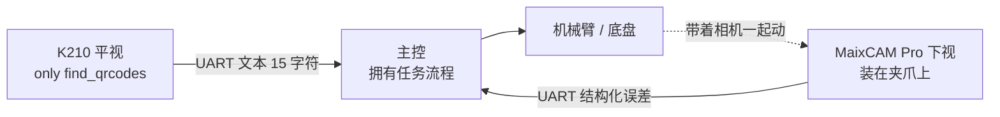

# 视觉端架构 v1 · MaixCAM Pro + K210

> 前提（已确认）：你只做视觉，整场流程归主控；视觉端保留**薄状态机**只管「当前在看什么」。
> 硬件：MaixCAM Pro 装夹爪下视（物料/圆环）；K210 平视只做扫码。
> **约束：小车尚无实体，只有结构图；场地只能拿到几小时。**

---

## 1. 拓扑（决定契约怎么切）



### 1.1 一个关键决定：K210 直连主控，不经 MaixCAM

**理由**：
- 二维码是**一次性事件**，不存在实时性要求，不需要和视觉帧同步
- 绕经 MaixCAM 会引入「两个 SoC 之间转发」的耦合，白增一处故障点
- **让视觉端不需要知道任务内容**——它只回答「画面里有什么」，主控决定「要哪个」

这最后一条很重要：视觉端**不做颜色编号 → 任务位置的映射**。那个映射表放主控。视觉端只输出「检测到颜色 3、颜色 6、颜色 1，各自在哪」。

**好处**：任务编码规则改了（比如决赛改成 4 组不同含义），视觉端一行代码都不用动。

### 1.2 代价

- 两个 SoC 时间基准不一致 → 但只要不跨设备做时序分析就无所谓。**所以心跳/延迟诊断只在 MaixCAM 一侧做，不跨到 K210。**
- 主控要接两路 UART → 引脚和缓冲规划要提前说

---

## 2. 契约：必须输出「增量误差」，不能输出「绝对坐标」

### 2.1 为什么这是核心决定

| | 绝对坐标 | **增量误差** |
|---|---|---|
| 需要什么标定 | **完整手眼标定**（相机→夹爪的旋转+平移 6 参数） | 只需 mm/px 比例 + 一个可能为 0 的旋转角 |
| 没车时能做吗 | **不能** | **能**（拿纸面靶标 + 手动移动就能标） |
| 底盘位姿误差 | 直接进结果，数 cm 级 | 被闭环吸收 |
| 主控怎么用 | 需要知道自己的全局位姿 | 只需 `move(ex, ey)` 然后重新请求 |

**结论**：输出「夹爪需要往 +X 移动多少 mm、往 +Y 移动多少 mm 才能对准环心」。主控循环执行「移动 → 再请求 → 再移动」，由主控判收敛。

这就是闭环视觉伺服，且它把最贵的标定工作降到了最低。

### 2.2 契约 v1.0（草案，待冻结）

```jsonc
// MaixCAM Pro → 主控，UART，一行一条（\n 分隔）
{
  "cv":  "1.0",
  "seq": 1234,          // 帧序号，用于发现丢帧
  "t":   123456,        // 设备启动后 ms，单调
  "dt":  12,            // 本帧处理耗时 ms
  "md":  "RING",        // 模式: RING | MAT | IDLE
  "st":  0,             // 0=OK 1=DEGRADED 2=LOST
  "n":   1,             // 有效目标数
  "tg": [
    {
      "c":    2,        // RING 模式: 环序号 1-3; MAT 模式: 颜色编号 1-6
      "ex":  -3.2,      // mm，夹爪需沿机器人 +X 移动的量
      "ey":   1.7,      // mm，夹爪需沿机器人 +Y 移动的量
      "ea":   0.8,      // deg，需旋转量（无旋转机构则恒 0）
      "px": 412.3,      // 像素坐标，仅调试用
      "py": 233.1,
      "cf":  91         // 置信度 0-100，整数省字节
    }
  ]
}
```

### 2.3 单位、坐标系、符号约定（冻结项）

| 项 | 约定 | 为什么必须写死 |
|---|---|---|
| 长度单位 | **mm，一位小数** | 主控按 mm 发运动指令，不给换算机会 |
| 坐标系 | **机器人坐标系，X 向前、Y 向左、Z 向上** | 视觉端只做一次图像→机器人轴的方向换算，主控不再想图像 |
| `ex` 符号 | **正值 = 夹爪往 +X 移动** | 符号反了车会往反方向走，且看起来「偶尔对偶尔错」 |
| `ea` 正方向 | 从上方看**逆时针为正** | 同上 |
| `t` 时基 | 设备启动后 ms，**单调递增，不受对时影响** | 延迟分析唯一可靠基准 |
| 失效判据 | 连续 **200ms** 无新消息 → 主控必须停止动作 | 防「拿旧数据继续控制」 |
| 分帧 | `\n` 结尾的 ASCII 行 | 不用二进制，出问题能肉眼读 |

### 2.4 薄状态机的三个模式（只有这么多）

| 模式 | 在看什么 | 何时进 | 何时退 |
|---|---|---|---|
| `RING` | 圆环 1/2/3 的位置 | 主控发 `SET:RING` | 主控发 `SET:MAT` 或 `SET:IDLE` |
| `MAT` | 物料颜色 + 位置 | 主控发 `SET:MAT` | 同上 |
| `IDLE` | 不看，只发心跳 | 主控发 `SET:IDLE` | 同上 |

**它只管「看什么」，不管「任务进行到第几步」**——后者是主控的事。所以这不违反「只有视觉端」的约束。

---

## 3. 骨架：MaixPy 平台上只要 6 + 3 个文件

我之前给的 12 文件版是 Python + OpenCV 思路，**在 MaixPy 上不成立**：sensor 取图、显示、串口、文件都在 SDK 里，不需要自己封装 source/sink。硬套 12 文件是给自己加维护成本。

```
vision_place/              # MaixCAM Pro 上，夹爪下视
├── main.py                # 入口 + 薄状态机 + 主循环 + UART 收 SET 指令
├── contract.py            # 契约结构 + 编码 + 发送。唯一编码入口
├── config.py              # 全部参数 + 标定值（mm/px、旋转角、阈值、ROI）
├── perceive.py            # 圆环定位 + 物料颜色。算法自由区
├── eval_task.py           # 离线：扫 data/gate 目录 → 打印 PASS/FAIL + 指标
├── calib_task.py          # 标定：显示靶标 → 算 mm/px 与旋转角 → 写回 config
└── data/
    └── gate/              # 5~10 张，每张一个失败模式；文件名编码期望值

vision_qr/                 # K210 上
├── main.py                # find_qrcodes + 校验 + UART 发 15 字符
└── config.py              # 分辨率、ROI、阈值、UART 参数
```

**注意 `eval_task.py` 必须跑在 MaixCAM 上**，不要在 PC 上用 `cv2` 另写一份检测逻辑——那就是「两份实现必然漂移」的经典坑。MaixCAM Pro 跑 Linux，可以直接 `scp` 改代码，不需要烧录，所以迭代不比 PC 慢。

---

## 4. 标定：没车也能做，且只需 2 步

### 4.1 需要什么

一块纸面靶标：**按真实尺寸打印圆环图案**（线宽 1.5mm，环径按 Σ 公式），贴在硬纸板上。

### 4.2 两步标定

**步 1：mm/px 比例**
- 相机固定在夹爪上，靶标放桌上
- 在图像里点两个已知距离的点（或让代码自动算环间距），得到 `mm_per_px`
- 也可以反过来：让夹爪沿 X 移动已知 10mm，看图像特征移动了多少像素 → 更准，因为它直接包含了机械实际行程

**步 2：旋转角 theta**
- 沿 X 和 Y 各移一次，看图像里的移动方向
- 若相机安装得正，theta ≈ 0；若偏了几度，必须记下来
- **输出 `ex/ey` 时先做这个旋转补偿**，主控就不用管

> 这两步不需要机械臂做任何绝对定位，只需要「能动」。**所以硬件晚到也能做**，只要机械能动一次。

### 4.3 相机装多高：可以装高，不必挤在 150mm

我之前算过：500mm 高度、60° 视场 → 0.30 mm/px，配上亚像素拟合，视觉误差约 0.1~0.3mm，**远低于 ±4mm 目标**。

所以装高一点更好，理由两条：

1. **视场大 → 伺服过程中环不容易跑出画面**（伺服失败最常见的原因就是目标出画）
2. 不容易被夹爪或物料本身遮挡

代价：太高时环在画面里变小、线宽 1.5mm 只占几个像素，拟合精度下降。**建议 300~400mm，实测决定。**

---

## 5. 没有实体车：把风险前移的四件事

### 5.1 桌面板（现在就做，一周内）

| 做什么 | 为什么 |
|---|---|
| 按**真实尺寸**打印计分环图案（1.5mm 线宽） | 线宽是检测难度的核心，缩放打印会给出假的乐观结果 |
| 拿到**真实 3D 打印物料**（6 色 × 2） | 色差只有实物才有；「蓝 vs 浅蓝」必须用实物标 |
| 用真实相机、按计划高度和俯角架起来 | 几何不变量 |
| 造一个黑色 Φ50×100 圆柱 | 专测「黑物料 vs 黑障碍」混淆 |

**这四样加起来几百块、几天时间**，但它是你唯一能在没车时积累 gate 集的途径。

### 5.2 相机架：按计划安装位置固定

即使车没造好，也要**先把相机的安装位置数值定下来**（高度、俯角、前后偏移），写进 `config.py` 并打版本号，用三脚架/木架按这个数值架相机录数据。

**铁律：支架一改，之前所有 gate 数据作废。** 而且不会报错，只是指标莫名变差。gate 只有 5~10 张，重录成本低——这正是它该少的理由。

### 5.3 几小时场地的使用协议（这是最贵的资源）

**去之前**（桌上必须已完成）：
- [ ] 圆环在桌面板上 PASS
- [ ] 颜色 12 个物料全对
- [ ] `eval_task.py` 能跑出报告
- [ ] 相机装在三脚架上，数值已定
- [ ] 打印好的**现场记录单**（谁拍、谁记、拍哪些角度）

**现场分四段，严格按照顺序**：
1. **先静态**：相机在三脚架上，按计划高度扫过全部区域，每个位置录 15 秒。**不动车，最快、最有用**
2. 再动态：手持相机按任务路径慢速移动，录「接近过程」
3. 再实车：如果车能动，录 L4/L5
4. **最后才调参**——不要一开始就调参，会浪费掉前面阶段

**铁律：现场只采集，不做算法开发。** 算法回桌上改。

### 5.4 机械精度要提前摊牌

±4mm 的瓶颈在机械（重复定位、松手滑移），不在视觉。**现在就去问机械那边两个数**：

- 末端重复定位精度是多少 mm？
- 释放机构怎么保证物料不滑？

如果他们说「大概几毫米吧」，那你实际能稳拿的是 3 环（±7.5mm）而不是 2 环。**这个结论现在就该写进预期，别到现场才发现。**

---

## 6. K210 扫码：算一下距离，这个数字会限制你的走位

15 字符 `156+123+516+231` 在标准 QR 里约 version 1~2，取 25 模块 → 80/25 = **3.2mm/模块**。

K210 受 8MB 内存限制，实用分辨率 **640×480**（320×240 太小）。60° 水平视场：

| 距离 | px/模块 | 能否解码 |
|---|---|---|
| 0.4m | 5.6 | 容易 |
| **0.6m** | **3.7** | **可行下限** |
| 0.8m | 2.8 | 勉强/不稳 |
| 1.0m | 2.2 | 基本不行 |

> **结论：K210 需要在 0.6m 内扫码。** 所以要设计一个「扫码位」，或把 K210 装在能提前对准的位置。
> 这是**必须实测验证**的一条，别按估算排流程。实测方法：把二维码按 80mm 打印，从 1.2m 开始逐步靠近，记录第一次稳定解码的距离。

**其他风险**：K210 是老平台、MaixPy v1 维护弱；覆膜反光是实际杀手；斜视角度会显著缩短距离。**建议给它留独立的时间预算，不要当成顺手能做掉的事。**

---

## 7. 视觉任务顺序（我建议的顺序，理由在最后一行）

| 顺序 | 任务 | 为什么这个顺序 |
|---|---|---|
| 1 | **V3 圆环精定位** | 精度瓶颈。若达不到 ±4mm → 整个方案要改（加机械被动对中）。先把最可能推翻方案的验证掉 |
| 2 | V2 物料颜色（抗色差、蓝/浅蓝、黑/黑） | gate 集的最大来源，需要真实物料 |
| 3 | V1 二维码（K210） | 独立模块，可与上两项并行；耗时主要花在实测距离上 |
| 4 | V4 车道 / V5 障碍 | **建议用灰度传感器而不是相机**（车道 400mm，余量 ±75mm，灰度传感器延迟更低、不受光照影响） |

---

## 8. 风险登记

| ID | 风险 | 等级 | 缓解 |
|---|---|---|---|
| R1 | 无实体车 → 手眼标定与 ±4mm 无法验证 | **高** | 增量误差契约 + 两步标定 + 桌面板 |
| R2 | 场地只有几小时 → 数据严重不足 | **高** | 现场协议 + 静态优先 + 桌面板覆盖大部分场景 |
| R3 | 机械精度未知，可能拿不到 2 环 | **高** | 现在就去要数；把预期下调到 3 环做预算 |
| R4 | 蓝(3)/浅蓝(6)、黑物料/黑障碍 混淆 | 中 | 相对比较 + 现场标定 + 尺寸/高度判据；gate 必收 |
| R5 | K210 扫码距离仅约 0.6m | 中 | 实测距离 → 设计扫码位 |
| R6 | MaixPy 不是 OpenCV，算子受限 | 中 | 一份实现跑在设备上；不要 PC 上另写一份 |
| R7 | 夹爪相机随臂运动 → 运动模糊/目标出画 | 中 | **离散伺服**：停稳→拍照→算→动，不在运动中取图 |
| R8 | 双 SoC 时基不一致 | 低 | 只做不跨设备的时序分析 |

### R7 展开：伺服是离散的，延迟要按「轮」算

相机在夹爪上，臂一动画面就糊、目标可能出画。所以：

```
停稳(需等机械停振, ~100-300ms?) → 取图 → 处理(~30-80ms) → 主控移动 → 回到停稳
```

**一轮约 0.3~0.8 秒。** 若需 3 轮收敛，单次放置约 1~2.5 秒。这个数字要写进时间预算，它比「30fps」有意义得多。

---

## 9. 现在这一步只做一件事

**建 `vision_place/` 的 6 个文件骨架，让 `main.py` 在假数据源下输出一条全零契约消息。**

具体：
- `contract.py` 里的字段按 §2.2 写死，`encode()` 是唯一入口
- `config.py` 里所有值先写 `None` 或 0 并标注「待标定」，**不许 agent 编数字**
- `perceive.py` 先返回 `st=2`（LOST）、`n=0`
- `eval_task.py` 先只做「遍历目录 → 打印张数」

验收：在 MaixCAM Pro 上跑 `main.py`，串口助手里看到 `{"cv":1.0,"seq":1,...,"st":2,"n":0}` 这样一行。

**这一小步同时验证了：串口通、编码对、契约格式对、帧循环在跑。** 之后再往 `perceive.py` 里填算法，出问题就只可能是算法。
