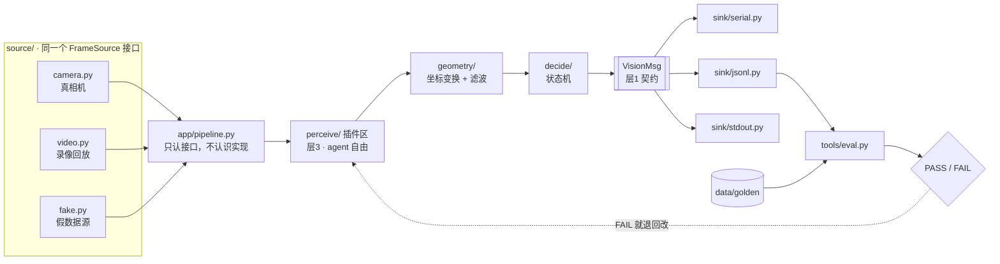
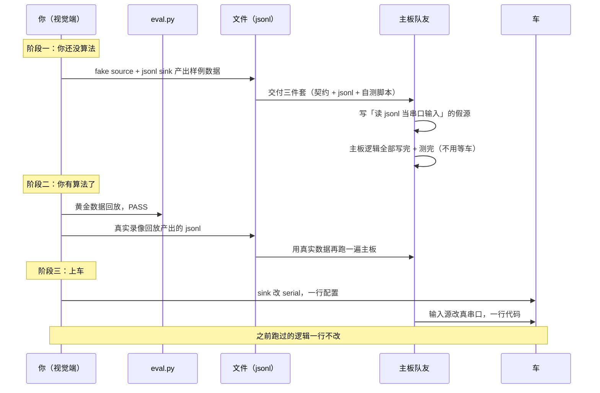

# 视觉端工程模板 v1（方案冻结稿 · 不含默认假设）

> 版本：v1.0 · 状态：**骨架方案**，待第 0 步填空完成后转 v1.1
> 本文件只定义 **结构与约束**，不含任何算法选型（层 3 全部留空）。
> 所有 `⟨…⟩` 为待填空位。未填 = 尚未决定，**不允许 agent 替填**。

---

## 1. 三层松紧模型（整个模板的核心）

| 层 | 内容 | 松紧 | 谁定 | 判据 |
|---|---|---|---|---|
| **层 1 接口层** | 输出契约、单位、坐标系、频率、异常语义、传输层、分帧与校验 | **钉死** | 你改，改必升版本 | 对方需不需要知道？改它对方代码要不要改？ |
| **层 2 编排层** | 数据流向、模块切分、配置外置、日志与记录、可回放 | **半固定** | 你定步骤，它定实现 | 它决定了「能不能测、能不能换、能不能回退」 |
| **层 3 算法层** | 用什么检测方法、什么滤波器、什么模型、内部参数 | **完全放开** | agent | 只要能过 `tools/eval.py` 就行 |

> 口诀：**层 1 写到能写测试，层 2 只定步骤不定实现，层 3 一句话不提。**
> 说太细导致「越走越偏」，几乎总是因为在**层 3 上过早收窄**；而层 1 放松才是真正危险。

---

## 2. 目录骨架（每个文件的职责）

```
vision/
├── configs/                     # 全部可调参数，代码里不许出现魔数
│   ├── camera.yaml              # 分辨率/帧率/曝光/增益/白平衡（锁定值）
│   ├── calib.yaml               # 内参/畸变/安装位姿（外参）
│   ├── task.yaml                # 阈值、ROI、工作距离、类别表
│   └── runtime.yaml             # source 选型、sink 选型、日志等级
│
├── src/vision/
│   ├── core/                    # 【层 1】钉死区，谁都不许改
│   │   ├── types.py             # VisionMsg / Object / Status 枚举 + CONTRACT_VERSION
│   │   ├── protocol.py          # 序列化：VisionMsg → bytes / 一行 json（唯一入口）
│   │   ├── interfaces.py        # FrameSource / Sink 两个 Protocol
│   │   ├── clock.py             # 统一时间源，只认帧时间戳
│   │   └── config.py            # 配置加载 + 启动时校验 + 打印全部生效参数
│   │
│   ├── source/                  # 【层 2】同一个 FrameSource 接口的多种实现
│   │   ├── camera.py            # 真相机（含缓冲策略/多线程只留最新帧）
│   │   ├── video.py             # 读 mp4/帧序列（离线回放用）
│   │   └── fake.py              # 假数据源：全黑/画方块/静态图 + 递增假时间戳
│   │
│   ├── perceive/                # 【层 3】自由区，可多插件并存，配置切换
│   │   ├── base.py              # 插件基类：detect(frame) -> list[Detection]
│   │   └── ⟨插件⟩.py            # 具体算法，agent 自由发挥
│   │
│   ├── geometry/                # 像素 → 米、外参变换、滤波（插件化）
│   │   ├── transform.py
│   │   └── filter.py            # 滤波策略可配，探索放这里
│   │
│   ├── decide/                  # 【层 2/3 之间】状态机，业务逻辑，可大幅放手
│   │   └── state_machine.py     # 搜索→接近→对准→完成 等，写进 docs/spec.md
│   │
│   ├── sink/                    # 【层 2】同一个 Sink 接口的多种实现
│   │   ├── serial.py            # 发串口（复用 core/protocol.py 编码）
│   │   ├── jsonl.py             # 写文件（内容与串口一模一样）
│   │   └── stdout.py            # 打屏幕，最快看效果
│   │
│   └── app/
│       ├── pipeline.py          # 接线：source → perceive → geometry → decide → sink
│       └── main.py              # 入口，读 runtime.yaml 决定用哪套
│
├── tools/                       # 全部可被 agent 直接执行的命令行
│   ├── record.py                # 录原始帧 + 时间戳
│   ├── replay.py                # 离线重放，逐帧跑完整 pipeline
│   ├── eval.py                  # ★核心：喂 golden → 输出 PASS/FAIL + 指标
│   ├── sweep.py                 # 参数扫描，出表
│   └── calibrate.py             # 内参/畸变标定
│
├── data/
│   ├── raw/                     # 原始录像（按 日期_场景_阶段 命名）
│   ├── golden/                  # 回归基准：gate 集 + eval 集 + labels
│   │   ├── gate/                # 5~10 样本，每个对应一个失败模式
│   │   ├── eval/                # 100+ 帧，来自 3~5 段录像
│   │   └── labels.yaml          # 人工核实过的期望输出
│   └── results/                 # eval 报告、sweep 表格
│
├── tests/
│   ├── test_geometry.py         # L1：坐标变换、单位换算
│   ├── test_protocol.py         # L1：编码/解码/校验/异常帧
│   ├── test_state_machine.py    # L1：状态转移、超时、丢帧
│   └── test_spine.py            # L0：fake source + jsonl sink 全链路能跑通
│
├── docs/
│   ├── spec.md                  # 你的目标 + 验收标准（1 页）
│   ├── contract.md              # ★由代码生成，禁止手改
│   ├── competition.md           # 赛事事实与判定标准（1 页，只写事实不写流程）
│   ├── latency_budget.md        # FPS/耗时/延迟/波特率的预算分配
│   ├── changelog.md             # 一行制变更记录
│   └── gaps.md                  # 已知覆盖缺口与风险
│
└── logs/                        # 运行日志、metrics
```

---

## 3. 数据流与回环



**要点**：`pipeline.py` 只认识 `FrameSource` 和 `Sink` 两个接口。换相机、换回放、换串口、换文件，都只改 `configs/runtime.yaml` 一行，代码零改动。

---

## 4. 两个接口 = 模板的技术支点

```python
# src/vision/core/interfaces.py 【层1】
class FrameSource(Protocol):
    def read(self) -> tuple[np.ndarray, int] | None:   # (帧, 帧时间戳ns)，None = 流结束
        ...
    def close(self) -> None: ...

class Sink(Protocol):
    def write(self, msg: VisionMsg) -> None: ...
    def close(self) -> None: ...
```

| 接口 | 实现 A | 实现 B | 实现 C |
|---|---|---|---|
| `FrameSource` | `camera.py` 真相机 | `video.py` 回放 | `fake.py` 假帧 |
| `Sink` | `serial.py` 串口 | `jsonl.py` 文件 | `stdout.py` 打印 |

**关键纪律**：`jsonl.py` 和 `serial.py` **必须共用 `core/protocol.py` 的同一个 `encode()`**，只是落地方式不同。不能让两边各自拼字符串，否则格式会漂移。

---

## 5. 与主板队友的联调时序



---

## 6. 输出契约（层 1，待你冻结）

### 6.1 文档必须包含的 8 个章节

| # | 章节 | 内容 | 最常被漏掉 |
|---|---|---|---|
| 1 | 元信息 | 版本号、日期、状态（草稿/冻结）、变更指引 | 没有「冻结」状态 |
| 2 | 传输层 | 介质、波特率、**分帧方式**、**校验**、字节序 | 分帧与校验（联调第一天必踩） |
| 3 | 字段表 | 名字、类型、**单位**、取值范围、语义 | 单位（mm/m、度/弧度） |
| 4 | 坐标约定 | 原点、XYZ 朝向、角度正方向、手系、**相机安装位姿** | 角度正方向（会导致车反向转） |
| 5 | 时序 | 发布频率、**时间戳来源与单位**、多久无消息判失效 | 时间戳是帧时间还是发送时间 |
| 6 | 状态与异常 | 枚举 + **每种状态下接收方必须怎么处理** | 只定义枚举，没定义行为 |
| 7 | 样例 | 一行真实数据 + 十六进制字节例 | 只有文字描述 |
| 8 | 变更记录 | 指向 changelog | 无 |

### 6.2 最小字段清单（结构，不是参数）

| 字段 | 作用 | 没有它会怎样 |
|---|---|---|
| `cv` | 契约版本，接收方强校验 | 版本不一致静默跑错 |
| `seq` | 检测丢帧、日志与录像对齐 | 丢帧不可见，以为满帧运行 |
| `t_capture` | 延迟测量、滤波、和队友日志对齐 | 所有时序分析做不了 |
| `status` | **接收方是否应该动作** | 对过期数据继续控制，车冲出去 |
| `objects[].cls` | 类别 | 分拣类任务必需 |
| `objects[].pos` | 位置（像素 或 米，二者选一并写死） | 核心数据 |
| `objects[].angle` | 朝向 | 有抓取/对准才需要 |
| `objects[].conf` | 质量 | 无法做阈值剔除 |
| `t_proc` | 单帧耗时（调试） | 性能退化不可见 |

**不要加**：原始图、完整协方差、历史轨迹、用不上的类别。每多一个字段 = 多测一次、多维护一处、多一个被误解的机会。

### 6.3 状态机（3 个，不要更多）

| 状态 | 含义 | 接收方必须做什么 |
|---|---|---|
| `OK` | 数据可信 | 可全速动作 |
| `DEGRADED` | 有数据但质量低（部分遮挡/低置信度） | 降速/保守 |
| `LOST` | 无可信目标 | 停止或进入搜索，**禁止沿用上一帧** |

> 繁杂不来自状态数量，来自「每个状态要定义接收方行为」。若主板逻辑简单，可退化成 `OK / LOST` 两态。

---

## 7. 验证阶梯（每级归属 + 是否需实地）

| 级 | 做法 | 谁做 | 需实地？ | 能证明什么 |
|---|---|---|---|---|
| **L0** | 能导入、能启动、fake 源跑通全链路 | agent 自跑 | 否 | 没有接线/语法/依赖错误 |
| **L1** | 单元测试：固定输入 → 固定输出 | agent 自跑 | 否 | 逻辑正确且**永久防回归** |
| **L2** | 离线回放：golden 集跑完整 pipeline | agent 自跑 | **否**（只需同机位的录像） | 算法在真实数据上的表现 |
| **L3** | 台架：相机对已知尺寸靶标，量绝对误差 | 你搭台，agent 写脚本 | **否**（书桌即可） | 标定正确、单位正确 |
| **L4** | 装车不动：只测通信与端到端延迟 | 你 + 队友 | 是 | 衔接没问题 |
| **L5** | 装车跑动：重复 N 次统计 | 你 | 是 | 真实成绩 |

> 只有 L4/L5 需要场地。**把最贵的场地时间留给 L5，前面的错都在桌上发现。**

### 7.1 L2 的判断标准（不是「复现比赛」，是「覆盖变量」）

把场景拆成**正交维度**，而不是试图还原现场：

| 维度 | 取值举例 |
|---|---|
| 距离 | ⟨0.3 / 0.6 / 1.0⟩ m |
| 方位 | 左 / 中 / 右 |
| 光照 | 正常 / 偏暗 / 逆光 |
| 背景 | 干净 / 杂乱 / 同色干扰 |
| 遮挡 | 无 / 露一半 |

- 组合出 12~20 个样本即可，不需要全组合。
- **硬性不变量**：同相机、同镜头、同安装高度与俯角。场景可变，几何关系不可变。
- 指标阈值写死（例：`pos_err ≤ ⟨1cm⟩ 的帧占比 ≥ 90%`、`FPS ≥ ⟨20⟩`、`P95 耗时 ≤ ⟨30⟩ms`）。
- 做不到的维度 → 写进 `docs/gaps.md`，标风险等级，用 L4/L5 补，并明确「哪些指标现在不能信」。

---

## 8. 黄金数据（golden）

### 8.1 两份，用途不同

| | gate 集 | eval 集 |
|---|---|---|
| 数量 | 5~10 | 100+ 帧 / 3~5 段录像 |
| 构成 | 1 个最正常场景 + **每个已知失败模式各 1** | 按维度覆盖表抽样 |
| 用途 | **PASS/FAIL 强制闸门** | 指标趋势（检测率、误差分布、FPS） |
| 变动 | 只增不减 | 可替换，但换了失去可比性 |

### 8.2 收录判据（两条同时满足）

1. **你知道正确答案**（人工核实，不是模型跑出来的）
2. **它对应一个具体失败模式或一条关键路径**

### 8.3 生长机制（最重要）

> **每修好一个 bug，就往 gate 集加一帧。**

这样覆盖度随项目自然增长，不需要你一开始预见所有情况。

### 8.4 拍摄范围

- **只拍任务阶段**（对视觉有信息量的阶段），开机/自检/纯行驶画面不录，否则稀释指标。
- 但要包含**接近阶段**（目标由远到近、进入视野的过程），它决定「第一次检出」的时刻。
- 分段拍，每段标注阶段名：`20261028_desk_approach_01.mp4`。

### 8.5 标注方式（按任务类型选，不是一律标米制）

| 任务类型 | 需标什么 | 成本 |
|---|---|---|
| 只要「识别对不对」（颜色/形状分类） | 文件名编码期望类别，脚本比 `cls` | ~0 |
| 需要像素定位（圆环中心、物料 bbox） | 中心像素 + 容差（例 ±15px） | 手工点两下 |
| 需要米制精度 | 卷尺量真值距离，写进 `labels.yaml` | 每样本实测 |

---

## 9. 分阶段路线（一步步搭，每步都能停下来验收）

| 阶段 | 交付物 | 验收（L 级） | 预计 | 依赖 |
|---|---|---|---|---|
| **0 冻结** | `spec.md` `competition.md` 填空表 + 契约草稿 | 人读能懂，无 `⟨…⟩` 残留 | 半天 | 你 + 赛事规则 |
| **1 骨架** | 目录 + `core/*` + `fake.py` + `stdout.py` + `test_spine.py` | **L0**：`main --source fake` 输出一条全零契约消息 | 半天 | 阶段 0 |
| **2 假算力闭环** | `jsonl.py` + `serial.py` 共用一个 `encode()` + `sink/serial.py` 桩 | **L0/L1**：`test_protocol.py` 全绿 | 半天 | 阶段 1 |
| **3 采集标定** | `camera.py` + `record.py` + `camera.yaml` + `calib.yaml` | **L3**：靶标测距误差达标；曝光锁定；FPS 实测 | 1 天 | 阶段 1 |
| **4 数据闭环** | `video.py` + `replay.py` + `eval.py` + golden 首批 | **L2**：能跑出报告，哪怕指标很差 | 1 天 | 阶段 3 |
| **5 最小感知** | 一个 `perceive/⟨插件⟩.py` 打通到契约 | **L2**：gate 集 PASS | 2~3 天 | 阶段 4 |
| **6 决策通信** | `state_machine.py` + 异常语义落地 | **L1/L4**：超时/丢帧/`LOST` 行为明确 | 1~2 天 | 阶段 2+5 |
| **7 鲁棒性** | `sweep.py` + `gaps.md` + 现场 checklist | **L5**：上车成功率统计 | 持续 | 阶段 6 |

> **铁律：先存数据和回放（阶段 4），再写算法（阶段 5）。** 90% 的人反过来做，结果调参全靠上车跑一次。

---

## 10. 第 0 步填空表（唯一的当前任务）

填不出就写「不确定 + 哪里能查到」。**不允许 agent 替你填。**

| 空位 | 内容 | 填错的代价 |
|---|---|---|
| A1 | 计算平台型号、系统、有无 NPU/独显 | 影响选型，改起来最贵 |
| A2 | 相机型号、分辨率、帧率、镜头视场角、**全局/卷帘快门** | 卷帘快门是动态误差的隐性来源 |
| A3 | 供电与散热 | 会降频，表现为「跑一会变慢」 |
| B1 | 与主板的物理接口与参数 | 决定 `sink/serial.py` |
| B2 | 视觉需要多少 Hz、主板控制周期 ms | 决定算法上限 |
| B3 | 从曝光到主板收到消息允许的延迟 ms | 决定要不要上轻量模型 |
| B4 | 消息字段最小必要集 | 契约核心 |
| B5 | 丢失/超时/低置信时的行为约定 | 联调时的争吵点 |
| C1 | 要输出哪些量（类别/2D/3D/角度/状态） | 贪多是最常见过度设计 |
| C2 | 精度要求与量纲 | 决定标定精度与镜头 |
| C3 | 工作距离范围 | 决定视场与焦距 |
| C4 | 成功率要求、单次任务允许耗时 | 决定验证强度 |
| C5 | 光照条件（逆光？反光？变化？） | 决定要不要补光 |
| D1 | 有无场地准入、能否预先录数据 | 没有数据 → L2 无法做，最大风险 |
| D2 | 距下次比赛几周、每天可投入时间 | 决定砍不砍功能 |
| D3 | 上车实测机会与次数 | 最稀缺资源，必须省着用 |

**参考起点（不是标准，必须被你的规则替换）**：搬运对位类 20~30Hz 通常够；端到端延迟 100ms 内对慢速移动基本无感，50ms 内才敢做快速对准；单次 30~60s 的比赛，1cm 级对位精度多数够用。

---

## 11. 变更与协作机制

### 11.1 改动分权

| 对象 | 谁改 | 规则 |
|---|---|---|
| `docs/contract.md` + `core/types.py` | **只你改** | 改必升版本 + changelog 一行 + 通知队友 |
| `configs/*.yaml` | 你改，或它提议你确认 | **禁止它在代码里写数字绕过配置** |
| `perceive/*.py` | 它自由改 | 必须过 `tools/eval.py` |
| `app/pipeline.py` | 它改但要说明 | 改动影响回放，必须跑一次 L0 + L2 |

### 11.2 越权检测（三个检查点，不是质量检测）

| 检查点 | 找什么 | 为何危险 |
|---|---|---|
| 代码里出现数字 | 本该从 yaml 读的参数被硬编码（魔数） | 改 yaml 无效、参数扫描失效、隐藏假设 |
| `contract.md` 被改动 | 是否升了版本 | 队友拿旧格式静默跑错 |
| 插件文件被删/被注释 | 是否封死了探索路径 | 后面想换方案得重写 |

> `grep -n "[0-9]\{2,\}" perceive/` 只是启发式，**会误报**（255 颜色上限、1000 毫米换算）。用法是「扫一眼确认」，不是「强制清零」。
> 更可靠的是 `core/config.py` 启动时**打印全部生效参数及其来源**，看有没有代码默认值覆盖了配置。

### 11.3 三个同步手段（不靠人的记忆）

1. **单一来源是代码**：契约写在 `core/types.py`，`contract.md` / `schema.json` 由脚本从代码生成，**文档禁止手改**。
2. **数据里带版本**：每条 jsonl / 串口消息带 `"cv": "1.3"`。
3. **对方代码强校验**：版本不匹配直接 `raise` 退出，不许警告后继续。

> 「保证队友会用到」的唯一可靠手段是**用代码强制**，不是沟通。

### 11.4 修 bug 的固定流程（回答「怎么知道问题解决了」）

```
1. 先做出一份能复现失败的样本 → 放进 data/golden/gate/
2. 跑 tools/eval.py → 必须是 FAIL（证明样本有效）
3. 让 agent 改
4. 跑 tools/eval.py → PASS 才算解决
5. 跑全量 tests/ → 防连锁破坏
```

**「有没有解决」必须由程序回答，不能由 agent 口头回答。**

---

## 12. 给 agent 的任务卡（每次对话开头粘贴）

```text
【阶段】⟨发散 / 收敛⟩     发散阶段禁止写代码，只出 2-3 方案 + 各自失效条件
【目标】⟨一句话：比赛里要发生什么⟩
【层 1 约束 · 不可改】
  - 输出结构见 docs/contract.md v⟨x⟩，字段/单位/坐标系不得变更
  - 频率 ≥ ⟨x⟩ Hz，单帧耗时 ≤ ⟨x⟩ ms
  - 硬件：⟨平台⟩ / ⟨相机+镜头+快门类型⟩ / 供电 ⟨x⟩
  - 通信：⟨串口参数⟩，异常语义见契约 ⟨章节⟩
【层 2 要求】
  - 必须能离线回放：给定录像可跑完整 pipeline 并输出指标
  - 参数全部从 configs/*.yaml 读，代码里不出现魔数
  - 日志必须含：帧时间戳、处理耗时、输出值
【层 3】不限制，但需说明选型理由与已知失效条件
【验收】⟨现象 + 数值 + 条件⟩，对应 L⟨1-5⟩
【本次只做】⟨最小一步⟩。做完停下汇报，不要顺手改其他文件。
汇报时必须给出三行：改了什么 / 我假设了什么 / 我给什么加了限制。
```

> 最后一行不能删：它同时解决「写得细就自己往下走」和「一次改太多无法回退」。
> **第三行最关键**——「假设」它常写，「限制」几乎从不主动写。

---

## 13. 当前状态

- [x] 结构方案（本文件）
- [ ] 第 0 步填空（A/B/C/D 四组）
- [ ] 契约草稿冻结 → v1.1
- [ ] 阶段 1 骨架落盘

> 下一步：填 A1~A3、B1~B5、C1~C5。填完再动代码。
